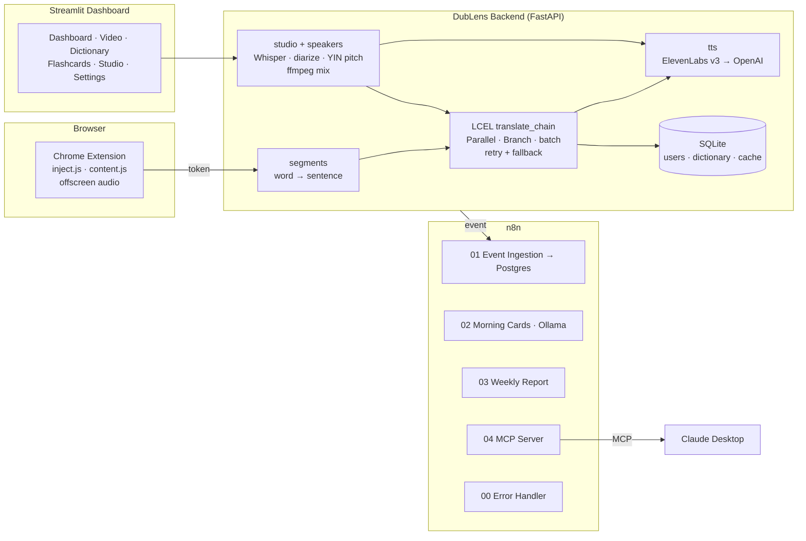

# DubLens 🎬 — Watch Any Video in Your Language

**DubLens** translates and dubs videos into Azerbaijani (plus Turkish, Russian, and English). It works in two ways:

- **Chrome Extension** — On YouTube and other sites with subtitles: translated subtitles, a bilingual mode (click a word → dictionary card), or live **dubbing** that plays in sync with the video.
- **Video Studio** — Upload your own video and choose: **dubbing or translation?** For dialogues, DubLens automatically detects speakers (2–4 people) and assigns a matching voice to each: a child gets a child's voice, an older man gets a deep male voice.

Unknown words are saved to a personal dictionary. Every morning, an AI-written mini lesson arrives by email (powered by n8n + Ollama).

## Architecture



## How It Works

### Extension (YouTube)
1. `inject.js` reads the subtitle file (json3) loaded by the player — it downloads and modifies nothing.
   If subtitles are off, the extension turns CC on automatically. If the file can't be captured, it live-translates the on-screen lines.
2. The backend reassembles fragmented auto-subtitles into proper sentences (using pauses, punctuation, and length) and translates in 40-sentence chunks: the section you're watching first, the rest in the background. Everything is cached.
3. **Dubbing**: each sentence's available time slot is calculated; if the translation is too long, the LLM shortens it. Audio plays in sync with the video via an offscreen document. If TTS audio is delayed, the video waits — audio is never cut off.
4. **Bilingual mode**: click a word → word card (lemma, meaning, example) → dictionary (Leitner system, 5 boxes) → n8n.

### Video Studio (Dashboard → Video)
1. ffmpeg extracts audio → **Whisper** (word-level timestamps) or for dialogues, **gpt-4o-transcribe-diarize** (who speaks when).
2. The same `translate_chain` translates the content.
3. **Translation** → subtitled MP4 + SRT. **Dubbing** → a voice for each speaker:
   - Pitch is measured with the **YIN** algorithm; speakers are compared → child / female / male / deep male.
   - Speakers who appear only once or twice (likely segmentation errors) are merged into the nearest voice.
   - Optionally, **ElevenLabs Instant Voice Clone** — everyone speaks in their own voice (paid plan; clones are deleted when the job finishes).
4. Voices are time-aligned: if a sentence doesn't fit, the LLM shortens it and re-synthesizes; if the previous speaker overlaps, they're softly faded out — delay never accumulates. Original audio is at 4% while dubbing speaks, 15% during pauses.
5. On the results page, you can **swap any speaker's voice** and re-synthesize; all jobs are kept in history.

### TTS
ElevenLabs (Azerbaijani → `eleven_v3`; Turkish/Russian/English → `eleven_multilingual_v2` in studio, `eleven_flash_v2_5` in extension), with neighboring sentences provided as context. If ElevenLabs fails (rate limit, auth error), the system automatically falls back to **OpenAI `gpt-4o-mini-tts`** and shows the reason in the dashboard.

## LCEL Chains (`backend/chains.py`)

| Chain | Structure |
|---|---|
| `translate_chain` | `RunnablePassthrough.assign(ctx=RunnableParallel(analysis, glossary))` → `_translate_all` (batches via `.batch(max_concurrency)`, second pass for missed lines) → `RunnableBranch(dub → _fit_for_dub)` → `_finalize` |
| `analysis_chain` | prompt → LLM (JSON) → parser: topic, domain, style, untouchable terms |
| `shorten_chain` | Dubbing: Python calculates timing, LLM shortens; in studio, actual audio duration is measured for a second round |
| `word_chain` | Clicked word: meaning in context, lemma, example sentence |
| `line_chain` | Live mode: single line with context |

All LLMs use `.with_retry(3)` + `.with_fallbacks([backup_model])`.

## n8n Workflows

| Workflow | Description |
|---|---|
| **00 · Error Handler** | Catches errors across all DubLens workflows → sends alert via Gmail |
| **01 · Event Ingestion** | `POST /webhook/dublens/event` → 202 → validation (Code node) → Switch → Postgres upsert, retry 3×3 |
| **02 · Morning Cards** | Hourly check: for users whose morning time has arrived, picks 5 words → **Ollama gemma4** writes a mini lesson + quiz → Gmail |
| **03 · Weekly Report** | Sundays at 20:00: videos watched, minutes, new words, topics → Gmail |
| **04 · MCP Server** | `lugetim`, `izlediklerim`, `soz_elave_et` — Claude Desktop reads and writes the dictionary |

## Tech Stack

- **Backend**: FastAPI, LangChain (LCEL), OpenAI, ElevenLabs, Whisper, ffmpeg
- **Frontend**: Streamlit (7 sections), Chrome Extension (Manifest V3)
- **Database**: SQLite (users, dictionary, translation cache)
- **Automation**: n8n (5 workflows), Ollama (local gemma4)
- **Deployment**: Docker Compose, Caddy (auto HTTPS), DigitalOcean
- **Testing**: Custom test suite with mocked API calls (no keys required)

## Getting Started

### Prerequisites
- Python 3.10+
- ffmpeg installed (`brew install ffmpeg` on macOS)
- OpenAI API key (required)
- ElevenLabs API key (optional — enables higher-quality dubbing voices)

### Local Setup
```bash
git clone https://github.com/sakinadd/DubLens.git
cd DubLens
cp .env.example .env        # Add your OPENAI_API_KEY; optionally ELEVENLABS_API_KEY
pip install -r requirements.txt
./run.sh                     # Starts API on :8000 and dashboard on :8501
```

Open the dashboard → register → go to the **Extension** section to get your token. **Settings → System Status** checks all services.

If using ElevenLabs, make sure these permissions are enabled on your API key: **Text to Speech**, **User: read** (and **Voices: write** for voice cloning).

### Chrome Extension
1. Go to `chrome://extensions` → enable **Developer mode** → **Load unpacked** → select the `extension/` folder.
2. Click the DubLens icon → **Connection**: enter server URL and token → **Save & Test**.
3. Open a YouTube video. Press <kbd>Alt</kbd>+<kbd>D</kbd> to toggle.

## Deploy to DigitalOcean

1. Create a Droplet: Ubuntu 24.04, **2 GB RAM** recommended (the script adds swap on 1 GB), with your SSH key.
2. Run from your machine:
   ```bash
   ./deploy/deploy.sh root@SERVER_IP
   ```
   The script copies files, installs Docker, sets `DOMAIN=<ip-with-dashes>.sslip.io` (free domain), and runs `docker compose up -d --build`. Caddy handles HTTPS certificates automatically.
3. Dashboard: `https://<ip>.sslip.io` · API: `https://api.<ip>.sslip.io/health`
4. In the extension, set the server URL to `https://api.<ip>.sslip.io`.
5. If n8n runs locally, set `N8N_EVENT_WEBHOOK` in `.env` to your ngrok URL.

## Tests

```bash
python tests/run_all.py
```

No API keys or internet connection needed — OpenAI and ElevenLabs are mocked with fake responses. Tests cover the backend (segments, LCEL chains, API, dictionary), all dashboard pages, video studio (MP4 streams), and dialogue processing (pitch detection, speaker grouping, voice assignment, fallback voices).

## Project Structure

```
DubLens/
├── backend/
│   ├── main.py          # FastAPI app & endpoints
│   ├── chains.py        # LCEL translation chains
│   ├── segments.py      # Subtitle segmentation
│   ├── speakers.py      # Speaker diarization & voice matching
│   ├── studio.py        # Video studio pipeline
│   ├── tts.py           # TTS with ElevenLabs/OpenAI fallback
│   ├── db.py            # SQLite models & queries
│   ├── config.py        # Environment & settings
│   ├── events.py        # n8n event dispatcher
│   └── status.py        # Service health checks
├── ui/
│   ├── app.py           # Streamlit entry point
│   ├── common.py        # Shared UI components
│   ├── login.py         # Auth pages
│   └── views/           # Dashboard sections
├── extension/
│   ├── manifest.json    # Chrome MV3 manifest
│   ├── inject.js        # Subtitle capture (page context)
│   ├── content.js       # Translation overlay & dubbing
│   ├── background.js    # Service worker
│   ├── offscreen.*      # Audio playback document
│   └── popup.*          # Extension popup UI
├── deploy/
│   ├── deploy.sh        # One-command DigitalOcean deploy
│   └── server_setup.sh  # Server provisioning
├── tests/               # Full test suite (mocked)
├── data/                # n8n workflow exports
├── docker-compose.yml
├── Dockerfile
├── Caddyfile
├── requirements.txt
├── run.sh
└── .env.example
```

## Known Limitations

- The extension works on YouTube and sites with standard HTML5 subtitles (`<track>` elements) — Coursera, TED, Vimeo, etc. Sites without subtitles and DRM-protected sites like Netflix are not supported.
- Studio videos are limited to 15 minutes; speaker diarization works best with 2–4 speakers.
- In overlapping speech, dubbing may briefly cut one speaker short.
- Pitch-based voice assignment estimates gender/age only; if it's wrong, you can change the voice on the results page.
- ElevenLabs free plan: ~10,000 characters/month, no cloning. When the limit is reached, OpenAI TTS takes over.
- Cost: translation ~$0.01–0.03 / 10 min, dubbing (OpenAI TTS) ~$0.10–0.25 / 10 min. Everything is cached.

## License

This project was built as a portfolio project. Feel free to explore the code.
