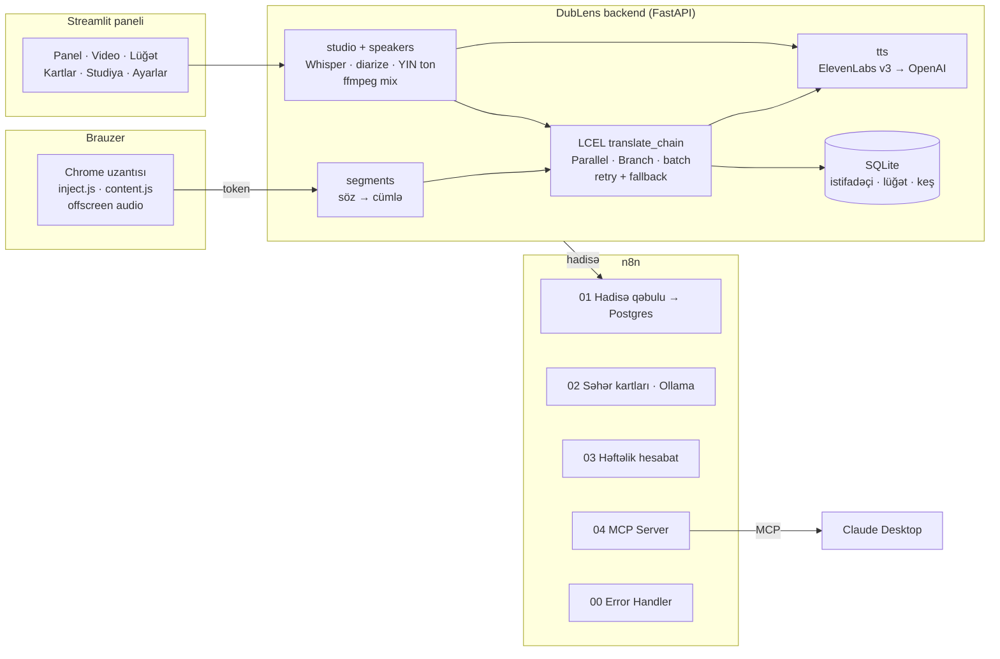

# DubLens 🎬 — istənilən videonu öz dilində izlə

**DubLens** videoları Azərbaycan dilinə (həmçinin türk, rus, ingilis) çevirir. İki yolla işləyir:

- **Chrome uzantısı** — YouTube-da və altyazılı video olan digər saytlarda altyazı, ikidilli rejim (sözə klik → lüğət) və ya canlı **dublyaj**.
- **Video studiya** — öz videonu yüklə, DubLens soruşur: **dublyaj, yoxsa tərcümə?** Dialoqda danışanları
  özü tapır (2–4 nəfər) və hər birinə uyğun səs verir: uşağa uşaq, yaşlı kişiyə dərin kişi səsi.

Bilmədiyin sözlər lüğətə düşür, hər səhər email-ə AI-ın yazdığı mini dərs kimi gəlir (n8n + Ollama).

## Arxitektura



## Necə işləyir

**Uzantı (YouTube)**
1. `inject.js` pleyerin yüklədiyi altyazı faylını (json3) oxuyur — heç nə yükləmir, dəyişdirmir.
   Altyazı bağlıdırsa, CC-ni özü açır. Fayl tutulmasa, ekrandakı sətirləri canlı tərcümə edir.
2. Backend qırıq avtomatik altyazını cümlələrə yığır (pauza, durğu, uzunluq) və 40 cümləlik hissələrlə
   tərcümə edir: əvvəl izlədiyin yer, qalanı arxa planda. Hər şey keşlənir.
3. **Dublyaj**: hər cümlənin sığmalı olduğu vaxt hesablanır, uzun tərcüməni LLM qısaldır, səs offscreen
   sənəddə video ilə sinxron oxunur. Səs gecikərsə video gözləyir — səs heç vaxt kəsilmir.
4. **İkidilli rejim**: sözə klik → söz kartı (lemma, mənası, nümunə) → lüğət (Leitner, 5 qutu) → n8n.

**Video studiya (panel → Video)**
1. ffmpeg səsi çıxarır → **Whisper** (söz-söz vaxt) və ya dialoqda **gpt-4o-transcribe-diarize** (kim nə vaxt danışır).
2. Eyni `translate_chain` tərcümə edir.
3. **Tərcümə** → altyazılı MP4 + SRT. **Dublyaj** → hər danışana səs:
   - səs tonu **YIN** alqoritmi ilə ölçülür, danışanlar bir-biri ilə müqayisə olunur → uşaq / qadın / kişi / dərin kişi;
   - bir-iki dəfə danışan "danışan" (ayırma səhvi) ən yaxın səsə birləşdirilir;
   - istəsən ElevenLabs **Instant Voice Clone** — hər kəs öz səsi ilə (ödənişli plan; klonlar iş bitəndə silinir).
4. Səslər vaxta bərkidilir: sığmayan cümləni LLM qısaldır və yenidən səsləndirir; əvvəlki danışan növbətinin
   vaxtına keçərsə yumşaq kəsilir — gecikmə toplanmır. Orijinal səs dublyaj danışanda 4%, fasilədə 15%.
5. Nəticə səhifəsində hər danışanın səsini dəyişib **yenidən səsləndirmək** olur; bütün işlər tarixçədə qalır.

**Səs**: ElevenLabs (az → `eleven_v3`; tr/ru/en → studiyada `eleven_multilingual_v2`, uzantıda `eleven_flash_v2_5`),
qonşu cümlələr kontekst kimi verilir. ElevenLabs düşsə (limit, icazə) avtomatik OpenAI `gpt-4o-mini-tts`-ə keçir
və səbəbi paneldə göstərilir.

## LCEL chain-ləri (`backend/chains.py`)
| Chain | Quruluş |
|---|---|
| `translate_chain` | `RunnablePassthrough.assign(ctx=RunnableParallel(analysis, glossary))` → `_translate_all` (paketlər `.batch(max_concurrency)`, buraxılan sətirlər üçün ikinci keçid) → `RunnableBranch(dub → _fit_for_dub)` → `_finalize` |
| `analysis_chain` | prompt → LLM (JSON) → parser: mövzu, sahə, üslub, toxunulmaz terminlər |
| `shorten_chain` | dublyaj: Python vaxtı sayır, LLM qısaldır; studiyada real səs uzunluğu ölçülüb ikinci dövrə |
| `word_chain` | kliklənən söz: cümlədəki mənası, lemma, nümunə |
| `line_chain` | canlı rejim: tək sətir kontekstlə |

Bütün LLM-lər: `.with_retry(3)` + `.with_fallbacks([ehtiyat model])`.

## n8n
| Workflow | Nə edir |
|---|---|
| **00 · Error Handler** | bütün DubLens workflow-larında xəta → Gmail |
| **01 · Hadisə qəbulu** | `POST /webhook/dublens/event` → 202 → yoxlama (Code) → Switch → Postgres upsert, retry 3×3 |
| **02 · Səhər kartları** | hər saat: saatı çatan istifadəçiyə 5 söz → **Ollama gemma4** mini dərs + test → Gmail |
| **03 · Həftəlik hesabat** | bazar 20:00: video, dəqiqə, yeni sözlər, mövzular → Gmail |
| **04 · MCP Server** | `lugetim`, `izlediklerim`, `soz_elave_et` — Claude Desktop lüğəti oxuyur və söz əlavə edir |

## Mentorun tələbləri
| Tələb | DubLens-də |
|---|---|
| `prompt \| llm \| parser`-dən mürəkkəb LCEL | RunnableParallel + Passthrough.assign + RunnableBranch + `.batch` + retry/fallback + Python yoxlama dövrəsi |
| n8n: error handling, retry, error workflow | 00 Error Handler, node-larda retry, Code-da yoxlama, Ollama düşəndə ehtiyat mətn |
| MCP | DubLens 04 — 3 Postgres tool |
| Ollama | DubLens 02 — gemma4 lokal mini dərs yazır |
| UI | Streamlit paneli (7 bölmə) + Chrome uzantısı |
| DigitalOcean deploy | Docker + compose + Caddy (avtomatik HTTPS), `deploy/deploy.sh` bir əmrlə |

## Mac-da işə salmaq
```bash
cd ~/PycharmProjects/DubLens
cp .env.example .env        # OPENAI_API_KEY, istəsən ELEVENLABS_API_KEY
pip install -r requirements.txt
./run.sh                    # API :8000 + panel :8501
```
Panel → qeydiyyat → **Uzantı** bölməsində token. **Ayarlar → Sistem vəziyyəti** bütün xidmətləri yoxlayır.

ElevenLabs açarında bu icazələr açıq olmalıdır: **Text to Speech**, **User: read** (klon üçün **Voices: write**).

### Uzantı
1. `chrome://extensions` → **Developer mode** → **Load unpacked** → `extension/`
2. DubLens ikonu → **Bağlantı**: server, token → **Yadda saxla və yoxla**
3. YouTube-da video aç. <kbd>Alt</kbd>+<kbd>D</kbd> — aç/bağla.

## DigitalOcean deploy
1. Droplet yarat: Ubuntu 24.04, **2 GB RAM** tövsiyə olunur (1 GB-da skript swap əlavə edir), SSH açarı ilə.
2. Mac-dan bir əmr:
   ```bash
   ./deploy/deploy.sh root@SERVER_IP
   ```
   Skript faylları köçürür, Docker-i quraşdırır, `DOMAIN=<ip-tirelərlə>.sslip.io` yazır (pulsuz domen),
   `docker compose up -d --build` edir. Caddy HTTPS sertifikatını özü alır.
3. Panel: `https://<ip>.sslip.io` · API: `https://api.<ip>.sslip.io/health`
4. Uzantıda server ünvanını `https://api.<ip>.sslip.io` et.
5. n8n lokal işləyirsə, `.env`-də `N8N_EVENT_WEBHOOK`-a ngrok ünvanını yaz.

## Testlər
```bash
python tests/run_all.py
```
Açar və internet lazım deyil — OpenAI / ElevenLabs saxta cavablarla əvəz olunur.
Backend (seqmentlər, LCEL, API, lüğət), bütün panel səhifələri, video studiya (MP4 axınları) və dialoq
(səs tonu ölçümü, danışan qrupları, səs paylanması, ehtiyat səs) yoxlanılır.

## Təqdimat ssenarisi (5 dəq)
1. **Problem** (30 san): ingiliscə video, Azərbaycan dilində dublyaj yoxdur.
2. **Uzantı** (1.5 dəq): YouTube → altyazı → ikidilli → sözə klik → lüğət → dublyaj rejimi.
3. **Video studiya** (1.5 dəq): dialoq videosu yüklə → Dublyaj → danışanlar avtomatik tapılır → nəticə, səsi dəyiş.
4. **Arxitektura** (1 dəq): LCEL zənciri, n8n workflow-ları (error handler, Ollama səhər kartı), MCP — Claude Desktop-da
   "lüğətimdə nə var?".
5. **Ayarlar → Sistem vəziyyəti**: hamısı yaşıl.

## Dürüst məhdudiyyətlər
- Uzantı YouTube-da və standart HTML5 altyazısı (`<track>`) olan saytlarda işləyir (Coursera, TED, Vimeo və s.).
  Altyazısı olmayan saytlar və Netflix kimi DRM ilə qorunan saytlar dəstəklənmir.
- Studiya videosu 15 dəqiqəyə qədər; danışanları ayırma 2–4 nəfər üçün ən yaxşı işləyir.
- Eyni anda danışılan yerlərdə (sözkəsmə) dublyaj bir danışanı qısa kəsə bilər.
- Səs tonu yalnız cinsi/yaşı təxmin edir; səhv olarsa nəticə səhifəsində səsi dəyişmək olur.
- ElevenLabs pulsuz planı: ayda ~10 000 simvol, klon yoxdur. Bitəndə OpenAI səsi işləyir.
- Xərc: tərcümə ~0.01–0.03$ / 10 dəq, dublyaj (OpenAI səs) ~0.10–0.25$ / 10 dəq. Hər şey keşlənir.
